# ЛР8 - Модель данных без классов: запись `Student` как словарь, валидация и сериализация
### Задание А

### `models.py`
```python
from datetime import date

STUDENT_FIELDS = ("fio", "birthdate", "group", "gpa")


def _check_text(value, name):
    """fio и group: строка, после strip() не пустая. Возвращает очищенную строку."""
    if not isinstance(value, str):
        raise ValueError(f"поле {name}: ожидается строка")
    value = value.strip()
    if value == "":
        raise ValueError(f"поле {name}: строка не должна быть пустой")
    return value


def _check_birthdate(value):
    """birthdate: строка YYYY-MM-DD, существующая дата, не в будущем."""
    if not isinstance(value, str):
        raise ValueError("поле birthdate: ожидается строка формата YYYY-MM-DD")
    try:
        d = date.fromisoformat(value)
    except ValueError:
        raise ValueError(f"поле birthdate: '{value}' не является датой формата YYYY-MM-DD")
    if d > date.today():
        raise ValueError(f"поле birthdate: дата '{value}' в будущем")
    return value


def _check_gpa(value):
    """gpa: int или float, 0 <= gpa <= 5. Возвращает float."""
    if not isinstance(value, (int, float)):
        raise ValueError("поле gpa: ожидается число (int или float)")
    if not (0 <= value <= 5):
        raise ValueError(f"поле gpa: значение {value} вне диапазона 0..5")
    return float(value)


def make_student(fio, birthdate, group, gpa):
    """Собирает запись студента, проверяя каждое поле.

    make_student("Иванов Иван Иванович", "2007-05-14", "БИВТ-26-6-1", 4.3)
    """
    return {
        "fio": _check_text(fio, "fio"),
        "birthdate": _check_birthdate(birthdate),
        "group": _check_text(group, "group"),
        "gpa": _check_gpa(gpa),
    }


def validate_student(rec):
    """Проверяет готовую запись: набор ключей и значения. При ошибке - ValueError."""
    if not isinstance(rec, dict):
        raise ValueError("запись должна быть словарём")
    if set(rec) != set(STUDENT_FIELDS):
        missing = set(STUDENT_FIELDS) - set(rec)
        extra = set(rec) - set(STUDENT_FIELDS)
        raise ValueError(f"неверный набор ключей: нет {sorted(missing)}, лишние {sorted(extra)}")
    _check_text(rec["fio"], "fio")
    _check_birthdate(rec["birthdate"])
    _check_text(rec["group"], "group")
    _check_gpa(rec["gpa"])


def student_age(rec, today=None):
    """Полных лет на дату (по умолчанию сегодня)."""
    b = date.fromisoformat(rec["birthdate"])
    today = today or date.today()
    age = today.year - b.year
    if (today.month, today.day) < (b.month, b.day):  # день рождения ещё не был
        age -= 1
    return age


def _years_word(n):
    """Правильная форма слова: 1 год, 2 года, 5 лет."""
    if 11 <= n % 100 <= 14:
        return "лет"
    if n % 10 == 1:
        return "год"
    if 2 <= n % 10 <= 4:
        return "года"
    return "лет"


def format_student(rec):
    """Иванов И.И. (БИВТ-26-6-1), 19 лет, GPA 4.30"""
    parts = rec["fio"].split()
    initials = "".join(p[0].upper() + "." for p in parts[1:3])
    name = parts[0] + (" " + initials if initials else "")
    age = student_age(rec)
    return f"{name} ({rec['group']}), {age} {_years_word(age)}, GPA {rec['gpa']:.2f}"


def student_to_dict(rec):
    """Копия записи (не тот же самый словарь) для сериализации."""
    validate_student(rec)
    return {key: rec[key] for key in STUDENT_FIELDS}


def student_from_dict(d):
    """Десериализация: берёт ровно нужные ключи, gpa приводит к float, валидирует."""
    if not isinstance(d, dict):
        raise ValueError("запись должна быть объектом (словарём)")
    for key in STUDENT_FIELDS:
        if key not in d:
            raise ValueError(f"нет поля {key}")
    return make_student(d["fio"], d["birthdate"], d["group"], d["gpa"])
```
**Структура записи `Student`** - словарь с фиксированным набором ключей из `STUDENT_FIELDS`:

| Поле | Тип | Описание |
|---|---|---|
| `fio` | `str` | ФИО, непустая строка |
| `birthdate` | `str` | дата `YYYY-MM-DD`, существует и не в будущем |
| `group` | `str` | группа, например `БИВТ-26-6-1`, непустая строка |
| `gpa` | `float` | средний балл 0...5 (`int` приводится к `float`) |

**Логика функций:**
1. **Вспомогательные `_check_text`, `_check_birthdate`, `_check_gpa`:** проверяют по одному полю и возбуждают `ValueError` с сообщением, из которого видно, какое поле и почему не подошло. Правила проверки написаны один раз и используются и в конструкторе, и в `validate_student`.
2. **`make_student`:** прогоняет все поля через проверки и собирает словарь. Строки очищаются через `strip()`, `gpa` приводится к `float`. Дата проверяется через `date.fromisoformat`, поэтому `2003-02-30` отклоняется. `bool` как `gpa` не допускается.
3. **`validate_student`:** проверяет готовый словарь. Сначала `set(rec) == set(STUDENT_FIELDS)` (в сообщении указано, каких ключей нет и какие лишние), затем значения каждого поля.
4. **`student_age`:** считает разницу годов и вычитает 1, если день рождения в этом году ещё не наступил (`(today.month, today.day) < (b.month, b.day)`). Параметр `today` позволяет проверять функцию на фиксированной дате.
5. **`format_student`:** формирует строку вида `Иванов И.И. (БИВТ-26-6-1), 19 лет, GPA 4.30`. Инициалы берутся из первых букв имени и отчества, слово «год/года/лет» подбирает `_years_word`, `gpa` выводится с двумя знаками.
6. **`student_to_dict`:** проверяет запись и возвращает её **копию** (новый словарь), а не тот же объект.
7. **`student_from_dict`:** берёт из словаря ровно нужные ключи (лишние игнорируются), при отсутствии ключа выдаёт `ValueError`, остальное делегирует `make_student`, который приводит `gpa` к `float` и проверяет значения.
8. **Нет `class`:** используются только словари и функции.

---

### Задание В

### `serialize.py`
```python
import json
from pathlib import Path

from src.lab08.models import student_to_dict, student_from_dict


def students_to_json(students, path):
    """Сохраняет список записей в JSON (массив объектов)."""
    data = [student_to_dict(s) for s in students]
    Path(path).parent.mkdir(parents=True, exist_ok=True)
    with open(path, "w", encoding="utf-8") as f:
        json.dump(data, f, ensure_ascii=False, indent=2)


def students_from_json(path):
    """Читает JSON-массив и возвращает список валидных записей.

    Политика: skip - битые записи пропускаются, в конце печатается,
    сколько пропущено и почему.
    """
    if not Path(path).is_file():
        raise FileNotFoundError(f"Файл не найден: {path}")
    with open(path, encoding="utf-8") as f:
        data = json.load(f)
    if not isinstance(data, list):
        raise ValueError("ожидается JSON-массив записей")

    students = []
    errors = []
    for number, item in enumerate(data, start=1):
        try:
            students.append(student_from_dict(item))
        except ValueError as e:
            errors.append(f"запись #{number}: {e}")

    if errors:
        print(f"Пропущено записей: {len(errors)}")
        for message in errors:
            print(f"  - {message}")
    return students
```
1. **`students_to_json`:** каждая запись превращается в копию через `student_to_dict` (заодно проверяется), затем весь список записывается как JSON-массив с `ensure_ascii=False` и `indent=2`. Папка для файла создаётся при необходимости.
2. **`students_from_json`:** читает JSON-массив, каждую запись прогоняет через `student_from_dict`. Если файла нет, возбуждается `FileNotFoundError`, если в файле не массив, то `ValueError`.
3. **Политика битых записей:** выбрана **`skip`**. Битая запись пропускается, остальные читаются дальше, а в конце в консоль выводится, сколько записей пропущено, с номером каждой записи (нумерация с 1) и причиной. Такая политика позволяет загрузить всё корректное из файла, а проблемные записи видны в отчёте.

---

## Пример работы models.py:

```python 
def main():
    s = make_student("Сидоров Пётр Олегович", "2007-09-20", "БИВТ-26-6-1", 4)
    print("Создан студент:", s)

    # 1. форматирование
    print("Форматирование:", format_student(s))

    # 2. возраст до и после дня рождения
    print(student_age(s, date(2026, 9, 19)), student_age(s, date(2026, 9, 20)))

    # 3. неверная дата и gpa = 7
    for args in (("Иванов Иван Иванович", "2003-02-30", "БИВТ-26-6-1", 4.0),
                 ("Иванов Иван Иванович", "2007-05-14", "БИВТ-26-6-1", 7)):
        try:
            make_student(*args)
        except ValueError as e:
            print("ValueError:", e)

if __name__ == "__main__":
    main()
```

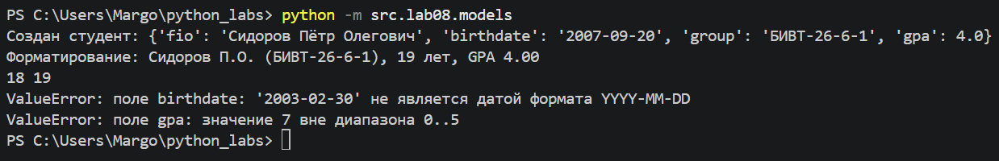

## Пример работы serialize.py
**До преобразования (`data/lab08/students_input.json`):**
```json
[
  {"fio": "Иванов Иван Иванович", "birthdate": "2007-05-14", "group": "БИВТ-26-6-1", "gpa": 4.3},
  {"fio": "Петрова Анна Сергеевна", "birthdate": "2006-11-02", "group": "БИВТ-26-6-2", "gpa": 3.75},
  {"fio": "Сидоров Пётр Олегович", "birthdate": "2007-09-20", "group": "БИВТ-26-6-1", "gpa": 5},
  {"fio": "  Козлова  Мария     Андреевна ", "birthdate": "2005-02-28", "group": "БИВТ-26-6-3", "gpa": 4.0}
]
```
Здесь у третьей записи `gpa` целое число (`5`), а в имени четвёртой лишние пробелы.

**Вывод в консоль:**
```
Иванов И.И. (БИВТ-26-6-1), 19 лет, GPA 4.30
Петрова А.С. (БИВТ-26-6-2), 19 лет, GPA 3.75
Сидоров П.О. (БИВТ-26-6-1), 19 лет, GPA 5.00
Козлова М.А. (БИВТ-26-6-3), 21 год, GPA 4.00
Записано: 4 записей в students_output.json
```
**После преобразования (`data/lab08/students_output.json`):**
```json
[
  {
    "fio": "Иванов Иван Иванович",
    "birthdate": "2007-05-14",
    "group": "БИВТ-26-6-1",
    "gpa": 4.3
  },
  {
    "fio": "Петрова Анна Сергеевна",
    "birthdate": "2006-11-02",
    "group": "БИВТ-26-6-2",
    "gpa": 3.75
  },
  {
    "fio": "Сидоров Пётр Олегович",
    "birthdate": "2007-09-20",
    "group": "БИВТ-26-6-1",
    "gpa": 5.0
  },
  {
    "fio": "Козлова Мария Андреевна",
    "birthdate": "2005-02-28",
    "group": "БИВТ-26-6-3",
    "gpa": 4.0
  }
]
```
Видно, что `5` стало `5.0`, а лишние пробелы в ФИО убраны.

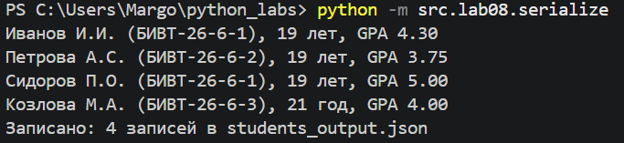

### Файл с битыми записями (`students_bad.json`)
**Входной файл:**
```json
[
  {"fio": "Иванов Иван Иванович", "birthdate": "2007-05-14", "group": "БИВТ-26-6-1", "gpa": 4.3},
  {"fio": "Смирнов Олег Петрович", "birthdate": "2003-02-30", "group": "БИВТ-26-6-1", "gpa": 4.0},
  {"fio": "Кузнецова Ольга Ивановна", "birthdate": "2006-03-15", "group": "БИВТ-26-6-2", "gpa": 7},
  {"fio": "Попов Дмитрий Сергеевич", "birthdate": "2006-07-01", "gpa": 3.5},
  {"fio": "   ", "birthdate": "2006-01-10", "group": "БИВТ-26-6-2", "gpa": 3.0},
  {"fio": "Орлова Ксения Павловна", "birthdate": "2006-12-05", "group": "БИВТ-26-6-3", "gpa": 4.8}
]
```
**Вывод в консоль:**
```
Пропущено записей: 4
  - запись #2: поле birthdate: '2003-02-30' не является датой формата YYYY-MM-DD
  - запись #3: поле gpa: значение 7 вне диапазона 0..5
  - запись #4: нет поля group
  - запись #5: поле fio: строка не должна быть пустой
Прочитано валидных: 2
```
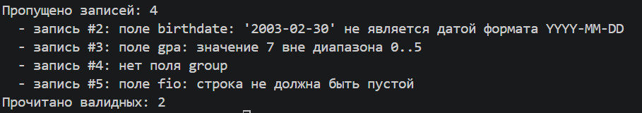

---
# ЛР8 - Модель данных без классов: запись `Student` как словарь, валидация и сериализация
### Задание А

### `models.py`
```python
from datetime import date

STUDENT_FIELDS = ("fio", "birthdate", "group", "gpa")


def _check_text(value, name):
    """fio и group: строка, после strip() не пустая. Возвращает очищенную строку."""
    if not isinstance(value, str):
        raise ValueError(f"поле {name}: ожидается строка")
    value = value.strip()
    if value == "":
        raise ValueError(f"поле {name}: строка не должна быть пустой")
    return value


def _check_birthdate(value):
    """birthdate: строка YYYY-MM-DD, существующая дата, не в будущем."""
    if not isinstance(value, str):
        raise ValueError("поле birthdate: ожидается строка формата YYYY-MM-DD")
    try:
        d = date.fromisoformat(value)
    except ValueError:
        raise ValueError(f"поле birthdate: '{value}' не является датой формата YYYY-MM-DD")
    if d > date.today():
        raise ValueError(f"поле birthdate: дата '{value}' в будущем")
    return value


def _check_gpa(value):
    """gpa: int или float, 0 <= gpa <= 5. Возвращает float."""
    if not isinstance(value, (int, float)):
        raise ValueError("поле gpa: ожидается число (int или float)")
    if not (0 <= value <= 5):
        raise ValueError(f"поле gpa: значение {value} вне диапазона 0..5")
    return float(value)


def make_student(fio, birthdate, group, gpa):
    """Собирает запись студента, проверяя каждое поле.

    make_student("Иванов Иван Иванович", "2007-05-14", "БИВТ-26-6-1", 4.3)
    """
    return {
        "fio": _check_text(fio, "fio"),
        "birthdate": _check_birthdate(birthdate),
        "group": _check_text(group, "group"),
        "gpa": _check_gpa(gpa),
    }


def validate_student(rec):
    """Проверяет готовую запись: набор ключей и значения. При ошибке - ValueError."""
    if not isinstance(rec, dict):
        raise ValueError("запись должна быть словарём")
    if set(rec) != set(STUDENT_FIELDS):
        missing = set(STUDENT_FIELDS) - set(rec)
        extra = set(rec) - set(STUDENT_FIELDS)
        raise ValueError(f"неверный набор ключей: нет {sorted(missing)}, лишние {sorted(extra)}")
    _check_text(rec["fio"], "fio")
    _check_birthdate(rec["birthdate"])
    _check_text(rec["group"], "group")
    _check_gpa(rec["gpa"])


def student_age(rec, today=None):
    """Полных лет на дату (по умолчанию сегодня)."""
    b = date.fromisoformat(rec["birthdate"])
    today = today or date.today()
    age = today.year - b.year
    if (today.month, today.day) < (b.month, b.day):  # день рождения ещё не был
        age -= 1
    return age


def _years_word(n):
    """Правильная форма слова: 1 год, 2 года, 5 лет."""
    if 11 <= n % 100 <= 14:
        return "лет"
    if n % 10 == 1:
        return "год"
    if 2 <= n % 10 <= 4:
        return "года"
    return "лет"


def format_student(rec):
    """Иванов И.И. (БИВТ-26-6-1), 19 лет, GPA 4.30"""
    parts = rec["fio"].split()
    initials = "".join(p[0].upper() + "." for p in parts[1:3])
    name = parts[0] + (" " + initials if initials else "")
    age = student_age(rec)
    return f"{name} ({rec['group']}), {age} {_years_word(age)}, GPA {rec['gpa']:.2f}"


def student_to_dict(rec):
    """Копия записи (не тот же самый словарь) для сериализации."""
    validate_student(rec)
    return {key: rec[key] for key in STUDENT_FIELDS}


def student_from_dict(d):
    """Десериализация: берёт ровно нужные ключи, gpa приводит к float, валидирует."""
    if not isinstance(d, dict):
        raise ValueError("запись должна быть объектом (словарём)")
    for key in STUDENT_FIELDS:
        if key not in d:
            raise ValueError(f"нет поля {key}")
    return make_student(d["fio"], d["birthdate"], d["group"], d["gpa"])
```
**Структура записи `Student`** - словарь с фиксированным набором ключей из `STUDENT_FIELDS`:

| Поле | Тип | Описание |
|---|---|---|
| `fio` | `str` | ФИО, непустая строка |
| `birthdate` | `str` | дата `YYYY-MM-DD`, существует и не в будущем |
| `group` | `str` | группа, например `БИВТ-26-6-1`, непустая строка |
| `gpa` | `float` | средний балл 0...5 (`int` приводится к `float`) |

**Логика функций:**
1. **Вспомогательные `_check_text`, `_check_birthdate`, `_check_gpa`:** проверяют по одному полю и возбуждают `ValueError` с сообщением, из которого видно, какое поле и почему не подошло. Правила проверки написаны один раз и используются и в конструкторе, и в `validate_student`.
2. **`make_student`:** прогоняет все поля через проверки и собирает словарь. Строки очищаются через `strip()`, `gpa` приводится к `float`. Дата проверяется через `date.fromisoformat`, поэтому `2003-02-30` отклоняется. `bool` как `gpa` не допускается.
3. **`validate_student`:** проверяет готовый словарь. Сначала `set(rec) == set(STUDENT_FIELDS)` (в сообщении указано, каких ключей нет и какие лишние), затем значения каждого поля.
4. **`student_age`:** считает разницу годов и вычитает 1, если день рождения в этом году ещё не наступил (`(today.month, today.day) < (b.month, b.day)`). Параметр `today` позволяет проверять функцию на фиксированной дате.
5. **`format_student`:** формирует строку вида `Иванов И.И. (БИВТ-26-6-1), 19 лет, GPA 4.30`. Инициалы берутся из первых букв имени и отчества, слово «год/года/лет» подбирает `_years_word`, `gpa` выводится с двумя знаками.
6. **`student_to_dict`:** проверяет запись и возвращает её **копию** (новый словарь), а не тот же объект.
7. **`student_from_dict`:** берёт из словаря ровно нужные ключи (лишние игнорируются), при отсутствии ключа выдаёт `ValueError`, остальное делегирует `make_student`, который приводит `gpa` к `float` и проверяет значения.
8. **Нет `class`:** используются только словари и функции.

---

### Задание В

### `serialize.py`
```python
import json
from pathlib import Path

from src.lab08.models import student_to_dict, student_from_dict


def students_to_json(students, path):
    """Сохраняет список записей в JSON (массив объектов)."""
    data = [student_to_dict(s) for s in students]
    Path(path).parent.mkdir(parents=True, exist_ok=True)
    with open(path, "w", encoding="utf-8") as f:
        json.dump(data, f, ensure_ascii=False, indent=2)


def students_from_json(path):
    """Читает JSON-массив и возвращает список валидных записей.

    Политика: skip - битые записи пропускаются, в конце печатается,
    сколько пропущено и почему.
    """
    if not Path(path).is_file():
        raise FileNotFoundError(f"Файл не найден: {path}")
    with open(path, encoding="utf-8") as f:
        data = json.load(f)
    if not isinstance(data, list):
        raise ValueError("ожидается JSON-массив записей")

    students = []
    errors = []
    for number, item in enumerate(data, start=1):
        try:
            students.append(student_from_dict(item))
        except ValueError as e:
            errors.append(f"запись #{number}: {e}")

    if errors:
        print(f"Пропущено записей: {len(errors)}")
        for message in errors:
            print(f"  - {message}")
    return students
```
1. **`students_to_json`:** каждая запись превращается в копию через `student_to_dict` (заодно проверяется), затем весь список записывается как JSON-массив с `ensure_ascii=False` и `indent=2`. Папка для файла создаётся при необходимости.
2. **`students_from_json`:** читает JSON-массив, каждую запись прогоняет через `student_from_dict`. Если файла нет, возбуждается `FileNotFoundError`, если в файле не массив, то `ValueError`.
3. **Политика битых записей:** выбрана **`skip`**. Битая запись пропускается, остальные читаются дальше, а в конце в консоль выводится, сколько записей пропущено, с номером каждой записи (нумерация с 1) и причиной. Такая политика позволяет загрузить всё корректное из файла, а проблемные записи видны в отчёте.

---

## Пример работы models.py:

```python 
def main():
    s = make_student("Сидоров Пётр Олегович", "2007-09-20", "БИВТ-26-6-1", 4)
    print("Создан студент:", s)

    # 1. форматирование
    print("Форматирование:", format_student(s))

    # 2. возраст до и после дня рождения
    print(student_age(s, date(2026, 9, 19)), student_age(s, date(2026, 9, 20)))

    # 3. неверная дата и gpa = 7
    for args in (("Иванов Иван Иванович", "2003-02-30", "БИВТ-26-6-1", 4.0),
                 ("Иванов Иван Иванович", "2007-05-14", "БИВТ-26-6-1", 7)):
        try:
            make_student(*args)
        except ValueError as e:
            print("ValueError:", e)

if __name__ == "__main__":
    main()
```


## Пример работы serialize.py
**До преобразования (`data/lab08/students_input.json`):**
```json
[
  {"fio": "Иванов Иван Иванович", "birthdate": "2007-05-14", "group": "БИВТ-26-6-1", "gpa": 4.3},
  {"fio": "Петрова Анна Сергеевна", "birthdate": "2006-11-02", "group": "БИВТ-26-6-2", "gpa": 3.75},
  {"fio": "Сидоров Пётр Олегович", "birthdate": "2007-09-20", "group": "БИВТ-26-6-1", "gpa": 5},
  {"fio": "  Козлова  Мария     Андреевна ", "birthdate": "2005-02-28", "group": "БИВТ-26-6-3", "gpa": 4.0}
]
```
Здесь у третьей записи `gpa` целое число (`5`), а в имени четвёртой лишние пробелы.

**Вывод в консоль:**
```
Иванов И.И. (БИВТ-26-6-1), 19 лет, GPA 4.30
Петрова А.С. (БИВТ-26-6-2), 19 лет, GPA 3.75
Сидоров П.О. (БИВТ-26-6-1), 19 лет, GPA 5.00
Козлова М.А. (БИВТ-26-6-3), 21 год, GPA 4.00
Записано: 4 записей в students_output.json
```
**После преобразования (`data/lab08/students_output.json`):**
```json
[
  {
    "fio": "Иванов Иван Иванович",
    "birthdate": "2007-05-14",
    "group": "БИВТ-26-6-1",
    "gpa": 4.3
  },
  {
    "fio": "Петрова Анна Сергеевна",
    "birthdate": "2006-11-02",
    "group": "БИВТ-26-6-2",
    "gpa": 3.75
  },
  {
    "fio": "Сидоров Пётр Олегович",
    "birthdate": "2007-09-20",
    "group": "БИВТ-26-6-1",
    "gpa": 5.0
  },
  {
    "fio": "Козлова Мария Андреевна",
    "birthdate": "2005-02-28",
    "group": "БИВТ-26-6-3",
    "gpa": 4.0
  }
]
```
Видно, что `5` стало `5.0`, а лишние пробелы в ФИО убраны.


### Файл с битыми записями (`students_bad.json`)
**Входной файл:**
```json
[
  {"fio": "Иванов Иван Иванович", "birthdate": "2007-05-14", "group": "БИВТ-26-6-1", "gpa": 4.3},
  {"fio": "Смирнов Олег Петрович", "birthdate": "2003-02-30", "group": "БИВТ-26-6-1", "gpa": 4.0},
  {"fio": "Кузнецова Ольга Ивановна", "birthdate": "2006-03-15", "group": "БИВТ-26-6-2", "gpa": 7},
  {"fio": "Попов Дмитрий Сергеевич", "birthdate": "2006-07-01", "gpa": 3.5},
  {"fio": "   ", "birthdate": "2006-01-10", "group": "БИВТ-26-6-2", "gpa": 3.0},
  {"fio": "Орлова Ксения Павловна", "birthdate": "2006-12-05", "group": "БИВТ-26-6-3", "gpa": 4.8}
]
```
**Вывод в консоль:**
```
Пропущено записей: 4
  - запись #2: поле birthdate: '2003-02-30' не является датой формата YYYY-MM-DD
  - запись #3: поле gpa: значение 7 вне диапазона 0..5
  - запись #4: нет поля group
  - запись #5: поле fio: строка не должна быть пустой
Прочитано валидных: 2
```


---

# ЛР7 - Поиск, сортировка и измерение времени
### Задание А

### `search.py`
```python
def linear_search(nums, x):
    """Индекс первого вхождения x или -1.

    linear_search([4, 2, 7, 2], 2) -> 1
    linear_search([4, 2, 7, 2], 9) -> -1
    linear_search([], 1) -> -1
    """
    for i in range(len(nums)):
        if nums[i] == x:
            return i
    return -1


def binary_search(sorted_nums, x):
    """Индекс x в отсортированном по возрастанию списке или -1.
    На неотсортированном списке результат не определён.

    binary_search([1, 3, 5, 7], 5) -> 2
    binary_search([1, 3, 5, 7], 4) -> -1
    binary_search([5], 5) -> 0
    binary_search([], 5) -> -1
    """
    lo = 0
    hi = len(sorted_nums) - 1
    while lo <= hi:
        mid = (lo + hi) // 2
        if sorted_nums[mid] == x:
            return mid
        elif sorted_nums[mid] < x:
            lo = mid + 1
        else:
            hi = mid - 1
    return -1


def two_sum_brute(nums, target):
    """Пара индексов (i, j), i < j, nums[i] + nums[j] == target, или None.

    two_sum_brute([2, 7, 11, 15], 9) -> (0, 1)
    two_sum_brute([1, 2], 10) -> None
    """
    for i in range(len(nums)):
        for j in range(i + 1, len(nums)):
            if nums[i] + nums[j] == target:
                return (i, j)
    return None


def two_sum_fast(nums, target):
    """То же, что two_sum_brute, но за один проход со словарём."""
    seen = {}  # значение -> индекс
    for j in range(len(nums)):
        need = target - nums[j]
        if need in seen:
            return (seen[need], j)
        seen[nums[j]] = j
    return None
```
1. **`linear_search`:** обычный проход по списку циклом `for`. При первом совпадении сразу возвращается индекс, если до конца ничего не нашли, возвращается `-1`.
2. **`binary_search`:** границы поиска хранятся в `lo` и `hi`. В цикле `while lo <= hi` берётся середина `mid`. Если элемент меньше искомого, поиск идёт в правой половине (`lo = mid + 1`), если больше, то в левой (`hi = mid - 1`). Когда `lo` стал больше `hi`, значения в списке нет и возвращается `-1`. Список должен быть уже отсортирован, на неотсортированном результат не определён (это указано в docstring).
3. **`two_sum_brute`:** два вложенных цикла перебирают все пары `(i, j)` с `i < j`. Это `O(n²)`.
4. **`two_sum_fast`:** один проход по списку со словарём `seen` («значение → индекс»). Для каждого числа проверяется, есть ли уже в словаре `target - nums[j]`. Проверка `in` у словаря работает за `O(1)`, поэтому весь алгоритм `O(n)`.

---

### Задание В

### `sorting.py`
```python
def bubble_sort(nums):
    """Новый список, отсортированный по возрастанию. Исходный не меняется.

    bubble_sort([3, 1, 2]) -> [1, 2, 3]
    bubble_sort([2, 2, 1]) -> [1, 2, 2]
    bubble_sort([]) -> []
    """
    nums = list(nums)
    n = len(nums)
    for i in range(n - 1):
        swapped = False
        for j in range(n - 1 - i):
            if nums[j] > nums[j + 1]:
                nums[j], nums[j + 1] = nums[j + 1], nums[j]
                swapped = True
        if not swapped:  # обменов не было - список уже отсортирован
            break
    return nums


def insertion_sort(nums):
    """Тот же контракт, что у bubble_sort."""
    nums = list(nums)
    for i in range(1, len(nums)):
        current = nums[i]
        j = i - 1
        while j >= 0 and nums[j] > current:
            nums[j + 1] = nums[j]
            j -= 1
        nums[j + 1] = current
    return nums


def selection_sort(nums):
    """Тот же контракт, что у bubble_sort."""
    nums = list(nums)
    n = len(nums)
    for i in range(n - 1):
        min_index = i
        for j in range(i + 1, n):
            if nums[j] < nums[min_index]:
                min_index = j
        nums[i], nums[min_index] = nums[min_index], nums[i]
    return nums
```
1. **Копия списка:** каждая функция начинается с `nums = list(nums)`, поэтому исходный список не меняется.
2. **`bubble_sort`:** на каждом проходе соседние элементы меняются местами, если стоят не по порядку, и максимум «всплывает» в конец. Флаг `swapped` даёт ранний выход: если за проход не было ни одного обмена, список уже отсортирован.
3. **`insertion_sort`:** очередной элемент `current` сдвигает влево все большие элементы и встаёт на своё место.
4. **`selection_sort`:** на каждом шаге в оставшейся части ищется индекс минимума (вручную, без `min`), и минимум ставится на позицию `i`.
5. Пустой список и список из одного элемента работают, так как циклы просто не выполняются.

---

### Задание С

### `check.py`
```python
import random

from src.lab07.search import linear_search, binary_search, two_sum_brute, two_sum_fast
from src.lab07.sorting import bubble_sort, insertion_sort, selection_sort

checks = 0  # счётчик выполненных проверок


def check_sorting(fn, trials=100):
    """Сравнивает fn(nums) со sorted(nums) на случайных списках."""
    global checks
    for _ in range(trials):
        n = random.randint(0, 50)
        nums = [random.randint(-100, 100) for _ in range(n)]
        original = list(nums)
        result = fn(nums)
        assert result == sorted(nums), f"{fn.__name__} ошиблась на {original}: {result}"
        assert nums == original, f"{fn.__name__} изменила исходный список {original}"
        checks += 1


def check_search():
    """linear_search против list.index, binary_search на отсортированных списках."""
    global checks
    for _ in range(100):
        n = random.randint(0, 50)
        nums = [random.randint(-20, 20) for _ in range(n)]
        x = random.randint(-25, 25)

        # linear_search: индекс первого вхождения, иначе -1
        try:
            expected = nums.index(x)
        except ValueError:
            expected = -1
        assert linear_search(nums, x) == expected, f"linear_search ошиблась на {nums}, x={x}"
        checks += 1

        # binary_search: на отсортированном списке
        sorted_nums = sorted(nums)
        i = binary_search(sorted_nums, x)
        if x in sorted_nums:
            assert i != -1 and sorted_nums[i] == x, f"binary_search не нашла {x} в {sorted_nums}"
        else:
            assert i == -1, f"binary_search нашла лишнее {x} в {sorted_nums}"
        checks += 1

        # крайние элементы
        if sorted_nums:
            for edge in (sorted_nums[0], sorted_nums[-1]):
                i = binary_search(sorted_nums, edge)
                assert i != -1 and sorted_nums[i] == edge, f"binary_search не нашла крайний {edge} в {sorted_nums}"
                checks += 1


def check_two_sum(trials=100):
    """Оба two_sum дают пару с нужной суммой или оба None."""
    global checks
    for _ in range(trials):
        n = random.randint(0, 30)
        nums = [random.randint(-50, 50) for _ in range(n)]
        target = random.randint(-100, 100)
        a = two_sum_brute(nums, target)
        b = two_sum_fast(nums, target)
        assert (a is None) == (b is None), f"two_sum разошлись на {nums}, target={target}: {a} и {b}"
        for pair in (a, b):
            if pair is not None:
                i, j = pair
                assert i < j and nums[i] + nums[j] == target, f"неверная пара {pair} на {nums}, target={target}"
        checks += 1


def main():
    random.seed(42)
    for fn in (bubble_sort, insertion_sort, selection_sort):
        check_sorting(fn)
    check_search()
    check_two_sum()
    print(f"OK: {checks} проверок")


if __name__ == "__main__":
    main()
```
1. **`check_sorting`:** 100 случайных списков длиной от 0 до 50 со значениями от -100 до 100 (с повторами и отрицательными). Результат сравнивается с `sorted(nums)`, а также проверяется, что исходный список не изменился. При ошибке `assert` показывает сам список.
2. **`check_search`:** `linear_search` сравнивается с `list.index` (`-1` вместо `ValueError`). `binary_search` проверяется на отсортированных списках: для найденного `x` проверяется `sorted_nums[i] == x`, для отсутствующего ожидается `-1`. Отдельно проверяются крайние элементы.
3. **`check_two_sum`:** оба решения должны одновременно вернуть `None` либо пару `i < j` с нужной суммой.
4. **Счётчик `checks`:** увеличивается после каждой успешной проверки, в конце печатается `OK: N проверок`. `random.seed(42)` делает запуск повторяемым.

---

### Задание D

### `bench.py`
```python
import random
import timeit

from src.lab04.io_txt_csv import write_csv
from src.lab07.search import linear_search, binary_search, two_sum_brute, two_sum_fast
from src.lab07.sorting import bubble_sort, insertion_sort, selection_sort

LIMIT_N = 10_000  # квадратичные сортировки на большем n не запускаем


def make_data(n):
    """Случайный список из n чисел (seed задан один раз в main)."""
    return [random.randint(0, 10 * n) for _ in range(n)]


def bench_sorts(n):
    data = make_data(n)
    rows = []
    t = timeit.timeit(lambda: sorted(data), number=1)
    rows.append(("sort", n, "sorted", t))
    for name, fn in (("bubble", bubble_sort), ("insertion", insertion_sort), ("selection", selection_sort)):
        if n > LIMIT_N:
            rows.append(("sort", n, name, "> 60 с"))  # слишком долго
        else:
            t = timeit.timeit(lambda: fn(data), number=1)
            rows.append(("sort", n, name, t))
    return rows


def bench_search(n=100_000, queries=10_000):
    data = make_data(n)
    xs = [random.choice(data) for _ in range(queries)]  # искомые значения есть в списке
    rows = []

    def run_linear():
        for x in xs:
            linear_search(data, x)

    t_lin = timeit.timeit(run_linear, number=1)
    rows.append(("search", n, "linear", t_lin))

    t_sort = timeit.timeit(lambda: sorted(data), number=1)
    sorted_data = sorted(data)

    def run_binary():
        for x in xs:
            binary_search(sorted_data, x)

    t_bin = timeit.timeit(run_binary, number=1)
    rows.append(("search", n, "binary", t_bin))
    rows.append(("search", n, "sorted_for_binary", t_sort))
    rows.append(("search", n, "binary+sort", t_bin + t_sort))
    return rows


def bench_two_sum(n):
    # большой разброс значений, чтобы другой пары с такой суммой почти не было
    data = [random.randint(0, 10**12) for _ in range(n)]
    target = data[-2] + data[-1]  # пара гарантированно существует (в конце списка)
    rows = []
    t = timeit.timeit(lambda: two_sum_brute(data, target), number=1)
    rows.append(("two_sum", n, "brute", t))
    t = timeit.timeit(lambda: two_sum_fast(data, target), number=1)
    rows.append(("two_sum", n, "fast", t))
    return rows


def print_table(rows):
    print(f"{'task':<10} | {'n':>8} | {'impl':<18} | {'seconds':>10}")
    print("-" * 50)
    for task, n, impl, sec in rows:
        if isinstance(sec, float):
            sec = f"{sec:.6f}"
        print(f"{task:<10} | {n:>8} | {impl:<18} | {sec:>10}")


def main():
    random.seed(42)
    rows = []
    for n in (1_000, 10_000, 100_000):
        rows += bench_sorts(n)
    rows += bench_search()
    for n in (1_000, 10_000):
        rows += bench_two_sum(n)

    print_table(rows)
    csv_rows = []
    for task, n, impl, sec in rows:
        if isinstance(sec, float):
            sec = f"{sec:.6f}"
        csv_rows.append((task, n, impl, sec))
    write_csv(csv_rows, "data/lab07/bench.csv", header=("task", "n", "impl", "seconds"))


if __name__ == "__main__":
    main()
```
1. **Одинаковые данные:** `random.seed(42)` задаётся один раз в `main`, а внутри одного замера все алгоритмы работают с одним и тем же списком `data`.
2. **Сортировки:** `sorted` и три свои сортировки замеряются через `timeit.timeit(..., number=1)` на `n = 1 000 / 10 000 / 100 000`. На `n = 100 000` квадратичные сортировки не запускаются, в таблице пишется `> 60 с` (оценка по теории: порядка 10¹⁰ шагов).
3. **Поиск:** 10 000 случайных запросов (значения берутся из списка) к списку из 100 000 элементов. Для бинарного поиска сортировка замеряется отдельной строкой `sorted_for_binary`, а в строке `binary+sort` время суммируется.
4. **Two Sum:** `target = data[-2] + data[-1]`, то есть пара гарантированно существует и находится в конце списка. Значения берутся из диапазона до 10¹², чтобы похожих пар почти не было и перебор честно прошёл почти все пары.
5. **Вывод:** таблица с выравниванием через f-строки печатается в консоль и записывается в `data/lab07/bench.csv` функцией `write_csv` (из ЛР4).

---

## Результат `check.py`

```
python -m src.lab07.check
OK: 794 проверок
```
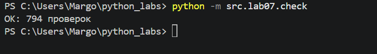

---

## Результат бенчмарка

Таблица из `data/lab07/bench.csv` (время в секундах, `random.seed(42)`):

```
task,n,impl,seconds
sort,1000,sorted,0.000170
sort,1000,bubble,0.088767
sort,1000,insertion,0.050307
sort,1000,selection,0.042396
sort,10000,sorted,0.002585
sort,10000,bubble,11.229788
sort,10000,insertion,4.666113
sort,10000,selection,3.888326
sort,100000,sorted,0.035394
sort,100000,bubble,> 60 с
sort,100000,insertion,> 60 с
sort,100000,selection,> 60 с
search,100000,linear,34.399756
search,100000,binary,0.044271
search,100000,sorted_for_binary,0.029511
search,100000,binary+sort,0.073782
two_sum,1000,brute,0.072951
two_sum,1000,fast,0.000366
two_sum,10000,brute,7.468968
two_sum,10000,fast,0.003619
```

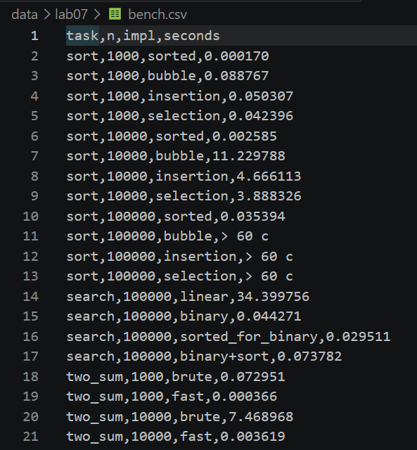

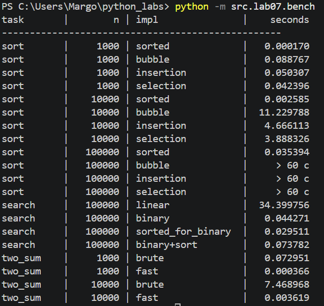

---

## Выводы

**Сортировки и поиск.** Для пузырька при росте `n` с 1 000 до 10 000 время выросло с 0,0888 с до 11,2298 с, то есть примерно в 126 раз. Это близко к ожидаемым ~100 раз для `O(n²)`: число шагов растёт как квадрат от роста `n` (10² = 100), а отклонение в большую сторону может быть связано с кэш-эффектами и накладными расходами на больших объёмах данных. Для `sorted` время выросло с 0,00017 с до 0,00259 с, то есть примерно в 15 раз: при `O(n log n)` число шагов растёт в 10 · (log 10⁴ / log 10³) ≈ 13 раз. Insertion и selection ведут себя похоже на пузырёк: на 10⁴ элементов они заняли 4,67 с и 3,89 с соответственно. На 10⁵ квадратичные сортировки не запускались (время выполнения превысило 60 с), так как это порядка 10¹⁰ шагов. Бинарный поиск без сортировки бесполезен, потому что он отбрасывает половину списка, исходя из того, что слева лежат меньшие значения, а справа большие. На неотсортированном списке это предположение неверно, и он может пропустить существующий элемент. Сортировка стоит одну операцию `O(n log n)` (0,0295 с для 10⁵ элементов), а один линейный запрос в среднем занимает около 3,4 мс (34,4 с на 100 000 запросов). Значит, сортировка окупается уже примерно после 9 запросов. На 100 000 запросов линейный поиск занял 34,4 с, а сортировка плюс бинарный поиск — 0,0738 с, это быстрее примерно в 466 раз. Если запрос всего один, выгоднее линейный поиск. Для Two Sum при `n = 10 000` перебор занял 7,47 с, а решение со словарём — 0,0036 с.

**Проверка против эталона.** `check.py` выполнил 794 проверки (по 100 случайных списков на каждую из трёх сортировок, 100 списков для поиска с проверкой крайних элементов, 100 прогонов Two Sum) и не нашёл ни одного расхождения, поэтому исправлять ничего не пришлось.

---

# ЛР6 - CLI-утилиты с argparse (cat/grep-lite + конвертеры)
### Задание А

### `cli_text.py`
```python
import argparse
from pathlib import Path

from src.lib.text import normalize, tokenize, count_freq, top_n
from src.lab04.io_txt_csv import read_text


def check_file(path: str) -> None:
    """Проверяет, что входной файл существует."""
    if not Path(path).is_file():
        raise FileNotFoundError(f"Файл не найден: {path}")


def cmd_cat(path: str, numbered: bool) -> None:
    """Выводит файл построчно, при numbered=True — с номерами."""
    check_file(path)
    text = read_text(path)
    number = 1
    for line in text.splitlines():
        if numbered:
            print(f"{number}. {line}")
        else:
            print(line)
        number += 1


def cmd_stats(path: str, top: int) -> None:
    """Выводит топ-N самых частых слов файла."""
    check_file(path)
    text = read_text(path)
    tokens = tokenize(normalize(text))
    freq = count_freq(tokens)

    print(f"Всего слов: {len(tokens)}")
    print(f"Уникальных слов: {len(freq)}")
    print(f"Топ-{top}:")
    for word, count in top_n(freq, top):
        print(f"{word}: {count}")


def main() -> None:
    parser = argparse.ArgumentParser(description="CLI-утилиты для работы с текстом")
    subparsers = parser.add_subparsers(dest="command")

    cat_parser = subparsers.add_parser("cat", help="Вывести содержимое файла")
    cat_parser.add_argument("--input", required=True, help="Путь к файлу")
    cat_parser.add_argument("-n", action="store_true", help="Нумеровать строки")

    stats_parser = subparsers.add_parser("stats", help="Частоты слов в тексте")
    stats_parser.add_argument("--input", required=True, help="Путь к текстовому файлу")
    stats_parser.add_argument("--top", type=int, default=5, help="Сколько слов выводить (по умолчанию 5)")

    args = parser.parse_args()

    if args.command is None:
        parser.error("нужно указать подкоманду: cat или stats")

    try:
        if args.command == "cat":
            cmd_cat(args.input, args.n)
        elif args.command == "stats":
            if args.top <= 0:
                parser.error("--top должно быть положительным числом")
            cmd_stats(args.input, args.top)
    except FileNotFoundError as e:
        print(f"Ошибка: {e}")


if __name__ == "__main__":
    main()
```
1. **Проверка файла:** функция `check_file` проверяет, что входной файл существует. Если его нет, возбуждается `FileNotFoundError` с понятным сообщением.
2. **Подкоманда `cat`:** функция `cmd_cat` читает файл через `read_text` (из ЛР4) и выводит его построчно. Если передан флаг `-n`, перед каждой строкой печатается её номер.
3. **Подкоманда `stats`:** функция `cmd_stats` пропускает текст через `normalize -> tokenize -> count_freq` (из ЛР3), выводит общее число слов, число уникальных слов и топ-N слов через `top_n`. Параметр `--top` по умолчанию равен 5.
4. **Разбор аргументов:** в `main` создаётся `ArgumentParser`, через `add_subparsers(dest="command")` добавляются подкоманды `cat` и `stats`. Каждой подкоманде задаются свои аргументы (`--input`, `-n`, `--top`).
5. **Ошибки:** если подкоманда не указана или `--top` не положительное, вызывается `parser.error(...)`. Если файла нет, `main` перехватывает `FileNotFoundError` и печатает `Ошибка: ...`.

---

### Задание В

### `cli_convert.py`
```python
import argparse

from src.lab05.json_csv import json_to_csv, csv_to_json
from src.lab05.csv_xlsx import csv_to_xlsx


def main() -> None:
    parser = argparse.ArgumentParser(description="Конвертеры данных (JSON, CSV, XLSX)")
    sub = parser.add_subparsers(dest="cmd")

    p1 = sub.add_parser("json2csv", help="Конвертировать JSON в CSV")
    p1.add_argument("--in", dest="input", required=True, help="Входной .json файл")
    p1.add_argument("--out", dest="output", required=True, help="Выходной .csv файл")

    p2 = sub.add_parser("csv2json", help="Конвертировать CSV в JSON")
    p2.add_argument("--in", dest="input", required=True, help="Входной .csv файл")
    p2.add_argument("--out", dest="output", required=True, help="Выходной .json файл")

    p3 = sub.add_parser("csv2xlsx", help="Конвертировать CSV в XLSX")
    p3.add_argument("--in", dest="input", required=True, help="Входной .csv файл")
    p3.add_argument("--out", dest="output", required=True, help="Выходной .xlsx файл")

    args = parser.parse_args()

    if args.cmd is None:
        parser.error("нужно указать подкоманду: json2csv, csv2json или csv2xlsx")

    try:
        if args.cmd == "json2csv":
            json_to_csv(args.input, args.output)
        elif args.cmd == "csv2json":
            csv_to_json(args.input, args.output)
        elif args.cmd == "csv2xlsx":
            csv_to_xlsx(args.input, args.output)
        print(f"Готово: {args.input} -> {args.output}")
    except FileNotFoundError as e:
        print(f"Ошибка: файл не найден ({e})")
    except ValueError as e:
        print(f"Ошибка: {e}")


if __name__ == "__main__":
    main()
```
1. **Импорт готовых функций:** конвертеры берутся из ЛР5 (`json_to_csv`, `csv_to_json`, `csv_to_xlsx`).
2. **Подкоманды:** через `add_subparsers(dest="cmd")` создаются `json2csv`, `csv2json` и `csv2xlsx`. У каждой есть обязательные аргументы `--in` и `--out`. Так как `in` является ключевым словом Python, значения сохраняются в `args.input` и `args.output` через параметр `dest`.
3. **Вызов функции:** в зависимости от `args.cmd` вызывается нужная функция из ЛР5. При успехе печатается сообщение `Готово: ... -> ...`.
4. **Ошибки:** `FileNotFoundError` и `ValueError` из функций ЛР5 перехватываются в `main`, выводится понятное сообщение.

---

## Способ запуска

Запуск выполняется из корня репозитория (там, где лежит папка `src/`), с помощью флага `-m`:

```
python -m src.lab06.cli_text <команда> [параметры]
python -m src.lab06.cli_convert <команда> [параметры]
```

| Программа | Команда | Параметры |
|---|---|---|
| `cli_text` | `cat` | `--input <путь>` (обязательный), `-n` (нумерация строк) |
| `cli_text` | `stats` | `--input <путь>` (обязательный), `--top <N>` (по умолчанию 5) |
| `cli_convert` | `json2csv` | `--in <файл.json>`, `--out <файл.csv>` |
| `cli_convert` | `csv2json` | `--in <файл.csv>`, `--out <файл.json>` |
| `cli_convert` | `csv2xlsx` | `--in <файл.csv>`, `--out <файл.xlsx>` |

---

## Тест-кейс А: `cat`

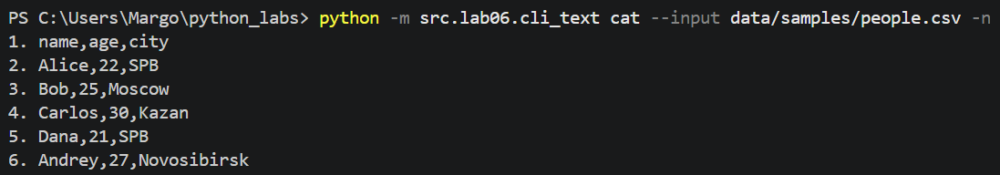

## Тест-кейс B: `stats`
**Входной файл (`data/lab06/text.txt`):**
```
Кот сидел на окне. Другой кот подошел к окну и тоже сел на окно. 
Первый кот посмотрел на второго кота. Кот, кот, еще один кот!
Окно было чистым, а солнце светило ярко.
```

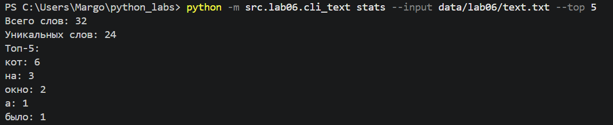

## Тест-кейс C: конвертеры
**Команды:**
```
python -m src.lab06.cli_convert json2csv --in data/samples/people.json --out data/out/people.csv
python -m src.lab06.cli_convert csv2json --in data/samples/people.csv --out data/out/people.json
python -m src.lab06.cli_convert csv2xlsx --in data/samples/people.csv --out data/out/people.xlsx
```
**Вывод в консоль (для каждой команды):**
```
Готово: data/samples/people.json -> data/out/people.csv
```
**Результат:** в папке `data/out/` созданы файлы `people.csv`, `people.json`, `people.xlsx`.

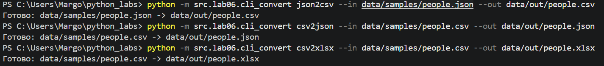

## Тест-кейс D: ошибки
**Файл не найден:**
```
python -m src.lab06.cli_text cat --input nope.txt
Ошибка: Файл не найден: nope.txt
```
**Неверное расширение:**
```
python -m src.lab06.cli_convert json2csv --in src/data/samples/people.csv --out x.csv
Ошибка: Неверный формат входного файла: ожидается .json
```
**Неверный аргумент:**
```
python -m src.lab06.cli_text stats --input src/data/samples/people.txt --top 0
usage: cli_text.py [-h] {cat,stats} ...
cli_text.py: error: --top должно быть положительным числом
```
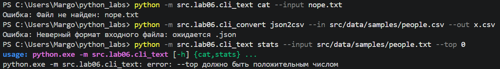

## Тест-кейс E: `--help`
```
python -m src.lab06.cli_text --help
```
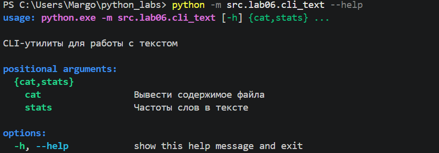

```
python -m src.lab06.cli_convert --help
```
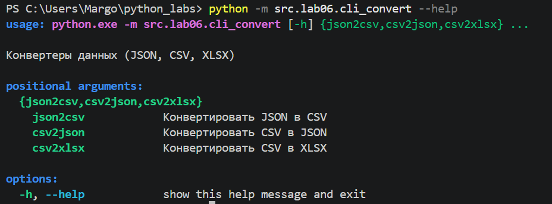

---

# ЛР5 - JSON и конвертации (JSON↔CSV, CSV→XLSX)
### Задание А

### `json_to_csv`
```python
from pathlib import Path
import json
import csv

from src.lab04.io_txt_csv import ensure_parent_dir, read_text, write_csv

def json_to_csv(json_path: str, csv_path: str) -> None:
    """
    Преобразует JSON-файл в CSV.
    Поддерживает список словарей [{...}, {...}], заполняет отсутствующие поля пустыми строками.
    Кодировка UTF-8. Порядок колонок — как в первом объекте.
    """
    json_file = Path(json_path)
    csv_file = Path(csv_path)
    if json_file.suffix.lower() != ".json":
        raise ValueError(f"Неверный формат входного файла: ожидается .json")
    if csv_file.suffix.lower() != ".csv":
        raise ValueError(f"Неверный формат выходного файла: ожидается .csv")
    if not json_file.exists():
        raise FileNotFoundError("Файл не найден")

     # читаем файл функцией из ЛР4
    text = read_text(json_path)

    if text.strip() == "":
        raise ValueError("Пустой JSON или неподдерживаемая структура")

    # превращаем текст в python-объект (список словарей)
    data = json.loads(text)
    
    if not isinstance(data, list) or not all(isinstance(value, dict) for value in data):
        raise ValueError("Ожидается список словарей")
    if not data:
        raise ValueError("Пустой JSON-файл")
    
    header = list(data[0].keys())
    if len(header) == 0:
        raise ValueError("Пустой JSON или неподдерживаемая структура")

    # превращаем каждый словарь в строку-список значений
    rows = []
    for item in data:
        row = []
        for column in header:
            row.append(item.get(column, ""))  # нет ключа -> пустая строка
        rows.append(row)

    # записываем функцией из ЛР4
    write_csv(rows, csv_path, header=tuple(header))
```
1. **Валидация форматов и путей:** Программа проверяет расширения файлов (`.json` для входящего и `.csv` для исходящего). Если форматы некорректны, генерируется `ValueError`. Затем проверяется физическое существование исходного файла; при его отсутствии генерируется `FileNotFoundError`.
2. **Чтение сырых данных:** С помощью внешней функции `read_text` (из ЛР4) файл считывается в строку. Отдельная проверка `.strip() == ""` страхует от пустых или содержащих только пробелы текстовых файлов, вызывая `ValueError`.
3. **Парсинг JSON-структуры:** Строка преобразуется в Python-объект методом `json.loads()`. Скрипт проверяет тип данных: если верхний уровень — не список (`list`), или хотя бы один вложенный элемент — не словарь (`dict`), возбуждается ошибка `ValueError("Ожидается список словарей")`. Также отсекается пустой список `[]`.
4. **Сборка заголовков столбцов:** В качестве названий колонок берутся ключи самого первого словаря в списке (`data[0].keys()`). Если у объекта нет ключей, программа прерывает выполнение. Порядок столбцов в итоговом CSV строго соответствует порядку полей в первом объекте.
5. **Выравнивание структуры и сборка строк:** Программа выполняет цикл по всем словарям. Для формирования «прямоугольной» таблицы обход полей каждого объекта идет строго по списку заголовков. Если в каком-то словаре отсутствует нужное поле, метод `.get(column, "")` автоматически заменяет его пустой строкой `""`.
6. **Сохранение:** Сформированный плоский двумерный массив `rows` и кортеж заголовков передаются в функцию `write_csv` (из ЛР4) для записи на диск в кодировке UTF-8.

---

### `csv_to_json`
```python
from pathlib import Path
import json
import csv

from src.lab04.io_txt_csv import ensure_parent_dir, read_text, write_csv

def csv_to_json(csv_path: str, json_path: str) -> None:
    """
    Преобразует CSV в JSON (список словарей).
    Заголовок обязателен, значения сохраняются как строки.
    """
    csv_file = Path(csv_path)
    json_file = Path(json_path)
    ensure_parent_dir(json_file)
    if json_file.suffix.lower() != ".json":
        raise ValueError(f"Неверный формат выходного файла: ожидается .json")
    if csv_file.suffix.lower() != ".csv":
        raise ValueError(f"Неверный формат входного файла: ожидается .csv")
    if not csv_file.exists():
        raise FileNotFoundError("Файл не найден")
    with csv_file.open(encoding="utf-8") as f:
        reader = csv.DictReader(f)
        if reader.fieldnames is None:
            raise ValueError("CSV не содержит заголовок")
        data = [row for row in reader]
    if not data:
        raise ValueError("Пустой CSV")
        
    with json_file.open("w", encoding="utf-8") as f:
        json.dump(data, f, ensure_ascii=False, indent=2)
```
1. **Предварительные проверки:** Скрипт обеспечивает подготовку родительской директории для выходного JSON-файла через `ensure_parent_dir()`. Проверяются расширения файлов (`.csv` на входе, `.json` на выходе) и факт существования источника. Нарушения вызывают `ValueError` или `FileNotFoundError`.
2. **Итерационное чтение:** Файл открывается с явным указанием кодировки `utf-8`. Чтение осуществляется встроенным классом `csv.DictReader()`, который автоматически сопоставляет первую строку таблицы с именами полей.
3. **Контроль структуры:** Скрипт проверяет свойство `reader.fieldnames`. Если заголовки в таблице полностью отсутствуют, вызывается исключение `ValueError`.
4. **Агрегация в список:** Все строки таблицы считываются в плоский список словарей через генератор списка. Если после чтения объект `data` оказывается пустым, программа выбрасывает `ValueError("Пустой CSV")`.
5. **Сериализация:** Полученный массив словарей записывается в файл функцией `json.dump()`. Параметры `ensure_ascii=False` предотвращают экранирование символов кириллицы (сохраняя читаемый текст), а `indent=2` форматирует JSON с красивыми отступами в два пробела.

---

### Задание В

### `csv_to_xlsx`
```python
import csv
from pathlib import Path

from openpyxl import Workbook
from openpyxl.utils import get_column_letter

from src.lab04.io_txt_csv import ensure_parent_dir


def csv_to_xlsx(csv_path: str, xlsx_path: str) -> None:
    """Конвертирует CSV в XLSX.

    Первая строка CSV — заголовок. Лист называется "Sheet1". 
    Ширина каждой колонки равна длине самого длинного значения, но не меньше 8 символов.
    Значения записываются как строки (типы не угадываются).

    Raises:
        FileNotFoundError: входного CSV нет.
        ValueError: неверное расширение, пустой CSV.
    """
    src = Path(csv_path)
    dst = Path(xlsx_path)
    if src.suffix.lower() != ".csv":
        raise ValueError(f"Неверный тип файла: ожидается .csv, получено '{src.suffix}'")
    if dst.suffix.lower() != ".xlsx":
        raise ValueError(f"Неверный тип файла: ожидается .xlsx, получено '{dst.suffix}'")
    if not src.is_file():
        raise FileNotFoundError(f"Файл не найден: {csv_path}")

    rows = []
    with open(csv_path, encoding="utf-8", newline="") as f:
        for row in csv.reader(f):
            if row:
                rows.append(row)

    # нужна хотя бы строка заголовка и одна строка данных
    if len(rows) < 2:
        raise ValueError("CSV пустой или в нём нет данных (только заголовок)")

    widths = {}
    for row in rows:
        for index, cell in enumerate(row):
            if len(cell) > widths.get(index, 0):
                widths[index] = len(cell)

    wb = Workbook()
    ws = wb.active
    ws.title = "Sheet1"
    for row in rows:
        ws.append(row)

    for index, width in widths.items():
        letter = get_column_letter(index + 1)
        ws.column_dimensions[letter].width = max(8, width)

    ensure_parent_dir(dst)
    wb.save(dst)
```
1. **Контроль расширений и путей:** Проверяется строгое соответствие типов (`.csv` для источника и `.xlsx` для приемника), а также существование входного CSV-файла. При ошибках генерируются `ValueError` и `FileNotFoundError`.
2. **Сбор строк:** Файл открывается в режиме чтения текстовых потоков. Объект `csv.reader()` последовательно считывает строки, отбрасывая пустые элементы, и аккумулирует их в общем массиве `rows`.
3. **Проверка наполненности:** Проверяется длина массива. Для успешной конвертации таблица должна содержать как минимум две строки (одну строку заголовков и хотя бы одну строку с контентом). При `len(rows) < 2` вызывается `ValueError`.
4. **Динамический расчет ширины колонок:** Алгоритм итерируется по всем ячейкам собранной таблицы. В словаре `widths` под индексом каждого столбца сохраняется длина самого длинного текстового значения, встреченного в процессе обхода.
5. **Генерация книги Excel:** Создается объект `Workbook` библиотеки `openpyxl`, активный рабочий лист переименовывается в `"Sheet1"`. Все строки переносятся на лист встроенным методом `ws.append()`.
6. **Выравнивание размеров ячеек:** Программа циклически обходит накопленные длины из словаря `widths`. Индексы столбцов переводятся в буквенный формат Excel (например, `0 -> A`) с помощью `get_column_letter()`. Размер столбца устанавливается как максимальное значение между вычисленной длиной и минимальным порогом в 8 символов (`max(8, width)`).
7. **Экспорт:** Готовый файл сохраняется на диск по указанному пути.

---

## Политика обработки краевых ситуаций и ошибок

*   **Отсутствие входного файла (`FileNotFoundError`):** если указанный файл не существует, функция возбуждает `FileNotFoundError`. Перехватывать его должен вызывающий код, сами функции ничего не печатают.
*   **Неверный тип файла (`ValueError`):** расширение входного и выходного файла проверяется (`.json`, `.csv`, `.xlsx`), при несовпадении возбуждается `ValueError`.
*   **Пустой JSON или неподдерживаемая структура (`ValueError`):** пустой файл, пустой список, не список (например, `{}`), список с не-словарями или объектами без ключей, а также некорректный JSON.
*   **Пустой CSV или CSV без данных (`ValueError`):** пустой файл, файл только с заголовком, пустые или повторяющиеся имена колонок, строка с большим числом значений, чем в заголовке.
*   **Разные ключи в JSON:** колонки CSV — объединение всех ключей, недостающие значения заполняются пустыми строками.
*   **Типы данных:** при CSV → JSON все значения остаются строками, а при JSON → CSV вложенные списки и словари записываются в ячейку как JSON-строка и обратно в структуру не восстанавливаются.

---

## Способ запуска

Запуск выполняется из корня репозитория (там, где лежит папка `src/`), с помощью флага `-m`. Для задания B нужна библиотека `openpyxl`:

```
pip install openpyxl
```

Использование функций из кода:

```python
from src.lab05.json_csv import json_to_csv, csv_to_json
from src.lab05.csv_xlsx import csv_to_xlsx

json_to_csv("data/samples/people.json", "data/out/people.csv")
csv_to_json("data/samples/people.csv", "data/out/people.json")
csv_to_xlsx("data/samples/people.csv", "data/out/people.xlsx")
```

---

## Тест-кейс А: JSON → CSV
**Входной файл (`data/samples/people.json`):**
```
[
  {"name": "Алиса", "age": 22, "city": "SPB"},
  {"name": "Боб", "age": 25, "city": "Moscow"},
  {"name": "Виктор", "age": 31, "city": "Kazan"},
  {"name": "Дарья", "age": 19, "city": "Tula"}
]
```

**Содержимое созданного файла (`data/out/people.csv`):**
```
name,age,city
Алиса,22,SPB
Боб,25,Moscow
Виктор,31,Kazan
Дарья,19,Tula
```

**Ошибка (пустой json файл):**
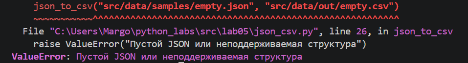

**Ошибка (неподдерживаемая структура):**
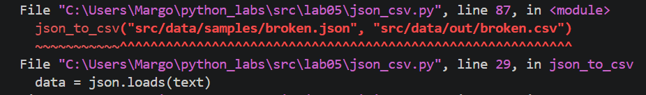

## Тест-кейс B: CSV → JSON
**Входной файл (`data/samples/people.csv`):**
```
name,age,city
Алиса,22,SPB
Боб,25,Moscow
Виктор,31,Kazan
Дарья,19,Tula
```

**Содержимое созданного файла (`data/out/people.json`), показаны первые два объекта:**
```
[
  {
    "name": "Алиса",
    "age": "22",
    "city": "SPB"
  },
  {
    "name": "Боб",
    "age": "25",
    "city": "Moscow"
  },
  ...
]
```
Значения `age` — строки, так как в CSV нет типов.

## Тест-кейс C: CSV → XLSX
**Входной файл (`data/samples/cities.csv`):**
```
city,country,population
SPB,Russia,5384342
Moscow,Russia,13010112
Kazan,Russia,1306953
Novosibirsk,Russia,1620162
Yekaterinburg,Russia,1493749
```

**Результат (`data/out/cities.xlsx`):** лист `Sheet1`, 6 строк (заголовок и 5 записей).
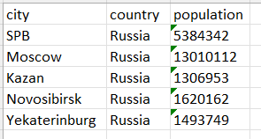

### Отсутствующие поля в JSON

Если у объектов разный набор ключей, недостающие значения заполняются пустыми строками.

**Вход:**
```json
[
  {"name": "Алиса", "age": 22},
  {"name": "Боб", "city": "Moscow"},
  {"city": "Kazan"},
  {"name": "Дарья", "age": 19, "city": "Tula"}
]
```

**Выход:**
```
name,age,city
Алиса,22,
Боб,,Moscow
,,Kazan
Дарья,19,Tula
```

---

# ЛР4 - Файлы: TXT/CSV и отчёты по текстовой статистике
### Задание А

### `read_text`
```python
def read_text(path: str | Path, encoding: str = "utf-8") -> str:
    """Прочитать файл целиком как одну строку.

    Кодировка по умолчанию — UTF-8. Если файл в другой кодировке
    (например, Windows-1251), передайте её явно::

        read_text("data/input.txt", encoding="cp1251")

    Исключения FileNotFoundError и UnicodeDecodeError не подавляются
    Файл читается целиком. Для очень больших файлов
    в реальных проектах стоит читать построчно.
    """
    p = Path(path)
    return p.read_text(encoding=encoding)
```
1. Принимает путь к файлу и преобразует его в объект класса `Path` для работы.
2. Вызывает встроенный метод `.read_text()`, который открывает файл, декодирует его в указанной кодировке и полностью считывает в оперативную память в виде единой строки.
3. Ошибки отсутствия файла (`FileNotFoundError`) или несовпадения кодировки (`UnicodeDecodeError`) намеренно не перехватываются, позволяя им «всплывать» в вызывающий скрипт.

---

### `write_csv`
```python
def ensure_parent_dir(path: str | Path) -> None:
    """Создать родительские директории для path, если их ещё нет."""
    Path(path).parent.mkdir(parents=True, exist_ok=True)

def write_csv(rows: Iterable[Sequence], path: str | Path, header: tuple[str, ...] | None = None) -> None:
    """Записать строки в CSV (разделитель ','). Перезаписывает файл.

    Если передан header — он записывается первой строкой.
    Все строки должны иметь одинаковую длину, иначе ValueError.
    """
    rows = list(rows)

    # Проверка одинаковой длины всех строк (включая header, если он задан)
    lengths = {len(r) for r in rows}
    if header is not None:
        lengths.add(len(header))
    if len(lengths) > 1:
        raise ValueError("Все строки должны иметь одинаковую длину")

    ensure_parent_dir(path)
    p = Path(path)
    with p.open("w", newline="", encoding="utf-8") as f:
        w = csv.writer(f)
        if header is not None:
            w.writerow(header)
        for r in rows:
            w.writerow(r)
```
1. `ensure_parent_dir` извлекает путь к содержащей папке целевого файла с помощью свойства `.parent`. Создает эту директорию методом `.mkdir()`. Флаг `parents=True` отвечает за рекурсивное создание вложенных папок, а `exist_ok=True` игнорирует ошибку, если папка уже существует.
2. `write_csv` принудительно конвертирует итерируемый объект строк в список `list(rows)` для фиксации данных в памяти.
3. Проверяет «прямоугольность» структуры: через генераторное множество собирает длины всех строк данных, а также длину заголовка `header` (если он передан). Если в множестве `lengths` оказывается больше одного значения, возбуждается исключение `ValueError`.
4. Вызывает функцию `ensure_parent_dir()` для гарантированного создания всех промежуточных папок перед сохранением.
5. Открывает файл через `p.open()` в режиме записи с параметром `newline=""`, предотвращающим появление пустых строк на Windows.
6. Инициализирует объект `csv.writer()`, записывает заголовок (при наличии), после чего в цикле `for` последовательно вносит в файл каждую строку данных.

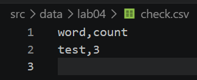

---

### Задание В
```python
from src.lib.text import normalize, tokenize, count_freq, top_n
from src.lab04.io_txt_csv import read_text, write_csv

def main():
    try:
        raw_text = read_text("data/lab04/input.txt", encoding="utf-8")
    except FileNotFoundError:
        print("Ошибка: файл не найден")
        return

    tokens = tokenize(normalize(raw_text))
    freq = count_freq(tokens)
    total_words = len(tokens)
    unique_words = len(freq)

    all_rows = sorted(freq.items(), key=lambda x: (-x[1], x[0]))
    top5 = top_n(freq, n=5)

    write_csv(all_rows, "data/lab04/report.csv", header=("word", "count"))

    print(f"Всего слов: {total_words}")
    print(f"Уникальных слов: {unique_words}")
    print("Топ-5:")
    for word, count in top5:
        print(f"{word}: {count}")


if __name__ == "__main__":
    main()
```
1. Скрипт пытается прочесть входной файл `input.txt` через функцию `read_text()`. Процесс обернут в блок `try-except`: при отсутствии файла выводится сообщение `Ошибка: файл не найден` и выполнение функции завершается через `return`.
2. Успешно прочитанная строка передается в функцию `normalize()` для приведения к единому регистру, замены `ё` на `е` и очистки от лишних спецсимволов. Результат сразу передается в `tokenize()` для разбиения текста на список слов-токенов.
3. Функция `count_freq()` собирает токены в частотный словарь. Общее количество слов вычисляется как длина списка токенов (`len(tokens)`), а число уникальных — как размер словаря (`len(freq)`).
4. Метод `freq.items()` превращает словарь в список пар `(слово, частота)`. Функция `sorted()` упорядочивает их по ключу `lambda x: (-x[1], x[0])`.
5. Функция `top_n()` извлекает 5 самых частотных элементов для последующего вывода.
6. Отсортированный массив `all_rows` передается в функцию `write_csv()`, которая записывает его на диск по пути `report.csv` вместе с заголовком столбцов `("word", "count")`.
7. В терминал через f-строки выводятся итоговые числовые метрики и список топ-слов в цикле `for`.

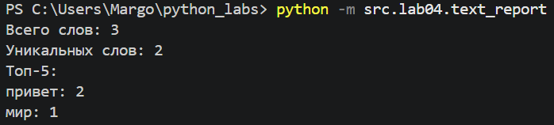
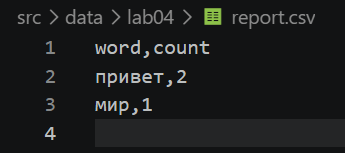

---

## Политика обработки краевых ситуаций и ошибок

*   **Отсутствие входного файла (`FileNotFoundError`):** Если указанный файл по заданному пути не существует, программа прерывает выполнение, выводит в консоль понятное сообщение об ошибке вида `[Ошибка]: Файл не найден` и завершает работу с кодом.
*   **Сбой декодирования (`UnicodeDecodeError`):** Если кодировка файла не соответствует заданной (например, попытка прочесть файл `cp1251` как `utf-8`), программа безопасно завершается с уведомлением пользователя о необходимости явного указания параметра `--encoding`.
*   **Обработка пустого файла:** При передаче абсолютно пустого файла программа не падает. В консоли выводится статистика о нулевом количестве слов, а в результирующем CSV-файле сохраняется **строка заголовка (`word,count`)** без контента.
*   **Большие файлы:** Настоящее ТЗ подразумевает полное считывание файла в оперативную память как одной строки. При обработке терабайтных логов в реальных условиях рекомендуется модифицировать логику чтения на построчный или блочный стриминг.
*   **Валидация CSV-строк:** В модуле `io_txt_csv.py` встроена проверка структуры данных. Если переданный двумерный массив содержит строки разной длины, вызывается исключение `ValueError`.

---

## Способ запуска `text_report.py`

Запуск выполняется из корня репозитория (там, где лежит папка `src/`), с помощью флага `-m`:

```python
python -m src.lab04.text_report
```

---

## Тест-кейс А: Базовый одиночный файл
**Входной файл (`data/lab04/input.txt`):**
```
Привет, мир! Привет!!!
```
**Вывод в консоль терминала:**
```
Всего слов: 3
Уникальных слов: 2
Топ-5:
привет: 2
мир: 1
```
**Содержимое созданного отчёта (`data/lab04/report.csv`):**
```
word,count
привет,2
мир,1
```

---

# ЛР3 - Тексты и частоты слов (словарь/множество)
### Задание А

### `normalize`
```python
def normalize(text: str, *, casefold: bool = True, yo2e: bool = True) -> str:
    """Привести текст к нормальной форме.

    Шаги нормализации:
      1. Регистр: ``casefold()``.
      2. Если ``yo2e=True`` — заменить ``ё``/``Ё`` на ``е``/``Е``.
      3. Заменить управляющие символы ``\\t``, ``\\r``, ``\\n`` на пробелы.
      4. «Схлопнуть» подряд идущие пробелы в один и обрезать края.
    """

    new_text = text
    # 1. Регистр
    if casefold:
        new_text = new_text.casefold()
    else: 
        new_text = new_text.lower()
    # 2. ё -> е
    if yo2e:
        new_text = new_text.replace('ё', 'е').replace('Ё', 'Е')
    # 3. Управляющие символы -> пробел
    for x in ("\t", "\r", "\n"):
        text = text.replace(x, " ")
    # 4. Схлопываем пробелы
    new_text = ' '.join(new_text.split())
    return new_text
```
1. `normalize`: Приводит входную строку к единому регистру через метод `.casefold()`, осуществляет склеивание букв `ё` и `е`, заменяет спецсимволы (`\n`, `\t`, `\r`) на пробелы, после чего «схлопывает» множественные пробелы с помощью комбинации функций `.split()` и `' '.join()`.

### `tokenize`
```python
import re

def tokenize(text: str) -> list[str]:
    """Разбить текст на слова.

    Слово — это шаблон ``\\w+(?:-\\w+)*``: буквы/цифры/подчёркивание,
    при этом внутри слова допускается дефис. Всё остальное (пробелы,
    знаки препинания, эмодзи, длинное тире ``—``) — разделители.
    Числа считаются словами.
    """

    return [match.group() for match in re.finditer(r"\w+(?:-\w+)*", text)]
```
2. `tokenize`: Извлекает слова из очищенного текста
    1. `re.finditer(r"...", text)`: Ищет все совпадения с регулярным выражением в строке text. Возвращает итератор, который выдает специальные объекты совпадений (Match-объекты) по одному за раз.
    2. `match.group()`: Метод объекта совпадения, который извлекает саму найденную строку текста.
    3. `[match.group() for match in ...]`:Это списковое включение. Оно пробегается по всем найденным Match-объектам и собирает их текстовое содержимое (match.group()) в один итоговый список.

    - `\w+` — находит одну или несколько букв, цифр или знаков подчеркивания.
    - `(?: ... )` — группирует символы внутри себя.
    - `-\w+` — ищет дефис, за которым идет еще одно слово (одна или несколько букв/цифр).
    - `*` — квантификатор, который означает «повторить группу от 0 до бесконечности раз».

### `count_freq`
```python
def count_freq(tokens: list[str]) -> dict[str, int]:
    """Подсчитать сколько раз каждое слово встречается в списке токенов.
    Возвращает словарь вида {слово: количество}.
    """
    freq = {}
    for token in tokens:
        # get(token, 0) возвращает текущий счётчик или 0 для нового слова.
        freq[token] = freq.get(token, 0) + 1
    return freq
```
3. `count_freq`: Проходит по сформированному списку токенов и аккумулирует их количество в словаре методом `.get(token, 0)`, страхующим от ошибок отсутствия ключа.

### `top_n`
```python
def top_n(freq: dict[str, int], n: int = 5) -> list[tuple[str, int]]:
    """Вернуть N самых частых слов.

    Пары ``(слово, частота)`` сортируются по ключу ``(-частота, слово)``:
    сначала по убыванию частоты, а при равенстве частот — по алфавиту.
    """

    return sorted(freq.items(), key=lambda x: (-x[1], x[0]))[:n]
```
4. `top_n`: Сортирует пары «слово-частота» встроенной функцией `sorted()` с использованием ключа сравнения `lambda x: (-x[1], x[0])`.

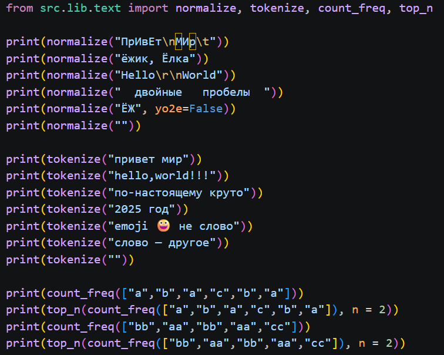
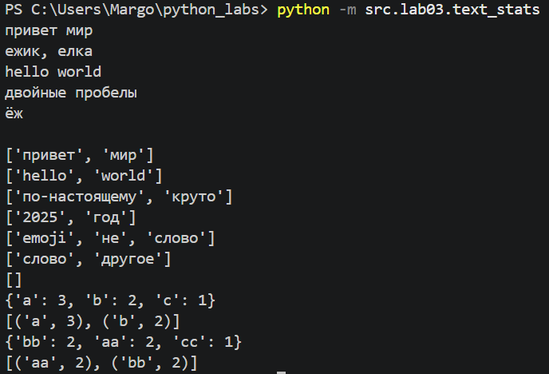

---

### Задание В
```python
import sys
from src.lib.text import normalize, tokenize, count_freq, top_n

def main() -> None:
    raw_text = sys.stdin.read()

    tokens = tokenize(normalize(raw_text))
    freq = count_freq(tokens)
    total_words = len(tokens)
    unique_words = len(freq)
 
    print(f"Всего слов: {total_words}")
    print(f"Уникальных слов: {unique_words}")
    print("Топ-5:")
 
    for word, count in top_n(freq, 5):
        print(f"{word}: {count}")
 
 
if __name__ == "__main__":
    main()
```
1. **Чтение потока:** Конструкция `sys.stdin.read()` позволяет полностью считать многострочный текст, передаваемый пользователем через консоль.
2. **Конвейер обработки:** Прочитанные сырые данные последовательно пропускаются через разработанную цепочку функций: `normalize -> tokenize -> count_freq`.
3. **Расчет метрик:** Общее число слов определяется через размер списка токенов (`len(tokens)`), а число уникальных слов — через размер словаря частот (`len(freq)`).
4. **Консольный вывод:** Скрипт печатает базовую информацию и выводит в цикле итоговый частотный список Топ-5 элементов.

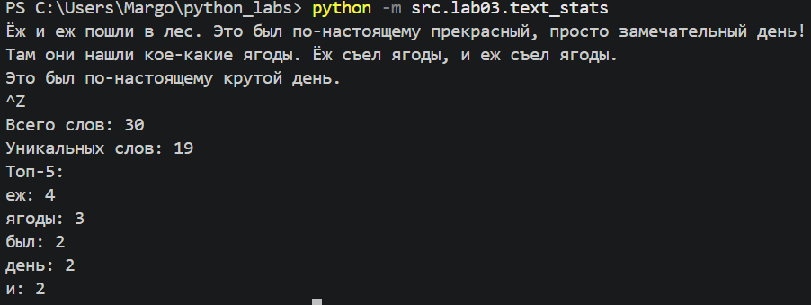

---

# ЛР2 - Коллекции и матрицы (list/tuple/set/dict)
### Задание 1 (arrays.py)
### min_max
```python
def min_max(nums: list[float | int]) -> tuple[float | int, float | int]:
    minn = 10**17
    maxx = -10**17
    if not nums:
        raise ValueError
    for x in nums:
        if x<minn:
            minn=x
        if x>maxx:
            maxx=x
    return minn, maxx
```
1. **Проверка на пустой список:** Проверяем переданную структуру данных. Если она не содержит элементов, генерируется исключение `raise ValueError`.
2. **Линейный обход:** В цикле `for` выполняется последовательное сравнение каждого элемента списка. Значения переменных перезаписываются при нахождении нового минимума или максимума.
3. **Возврат результата:** По завершении обхода функция возвращает кортеж формата `(минимум, максимум)`.

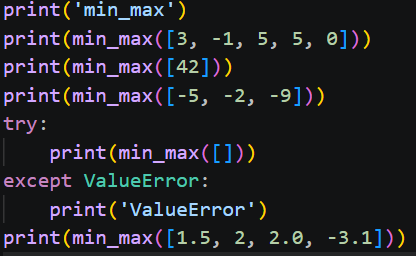
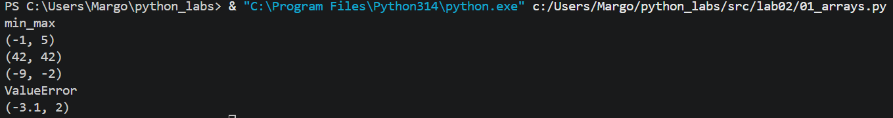

### unique_sorted
```python
def unique_sorted(nums: list[float | int]) -> list[float | int]:
    nums = list(set(nums))
    flag = True
    while flag:
        flag = False
        for i in range(len(nums)-1):
            if nums[i]>nums[i+1]:
                nums[i], nums[i+1] = nums[i+1], nums[i]
                flag = True
    return nums
```
1. **Фильтрация дубликатов:** Переданный список `nums` преобразуется во множество `set(nums)`, что автоматически удаляет все повторяющиеся элементы, после чего снова приводится к типу `list`.
2. **Cортировка:** Очищенный от дубликатов список сортируется вручную. Переменная `flag` отслеживает, были ли перестановки элементов во время текущего прохода по списку.
3. **Линейное сравнение и перестановка:** Вложенный цикл `for` сравнивает соседние элементы (`nums[i]` и `nums[i+1]`). Если текущий элемент больше следующего, они меняются местами, а флаг принимает значение `True` для запуска следующей итерации `while`.
4. **Возврат результата:** Алгоритм завершается, когда список полностью упорядочен (проход выполняется без единой перестановки), и функция возвращает отсортированный массив уникальных значений.

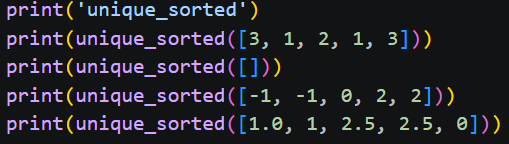
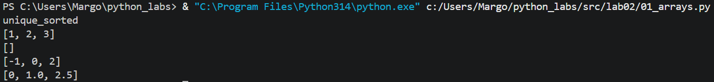

### flatten
```python
def flatten(mat: list[list | tuple]) -> list:
    result = []
    for i in mat:
        if isinstance(i, (list, tuple)):
            result += i
        else:
            raise TypeError
    return result
```
1. Создается пустой список `result`, в который последовательно будут собираться элементы из вложенных структур.
2. **Проверка типов:** В цикле `for` программа перебирает элементы внешнего списка `mat`. На каждой итерации встроенная функция `isinstance(i, (list, tuple))` проверяет, является ли текущий элемент списком или кортежем.
3. **Объединение коллекций:** Если проверка пройдена успешно, вложенная структура приводится к типу `list` и добавляется в конечный список.
4. **Валидация структуры:** Если обнаруживается элемент другого типа (например, строка или число), выполнение прерывается инструкцией `raise TypeError`. По завершении корректного обхода функция возвращает список.

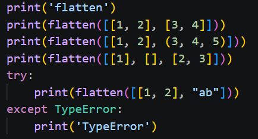
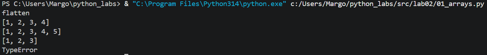

---

### Задание 2 (matrix.py)
### transpose
```python
def transpose(mat: list[list[float | int]]) -> list[list]:
    if any(len(mat[i])!=len(mat[i+1]) for i in range(len(mat)-1)):
        raise ValueError
    result = []
    if len(mat)>0:
        for i in range(len(mat[0])):
            result.append([mat[j][i] for j in range(len(mat))])
    return result
```
1. **Валидация прямоугольности:** С помощью выражения внутри `any()` проверяется равенство длин всех соседних строк матрицы. Если найдено несоответствие, генерируется ошибка `raise ValueError`.
2. **Инициализация:** Создается пустой список `result` для будущей транспонированной матрицы.
3. **Обход по столбцам:** Внешний цикл итерируется по индексам элементов первой строки.
4. **Сборка новых строк:** С помощью спискового включения `[mat[j][i] for j in range(len(mat))]` элементы текущего столбца из всех строк `j` собираются в новую строку и добавляются в `result`.

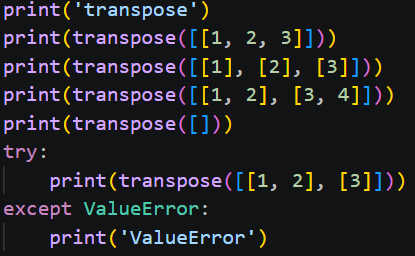
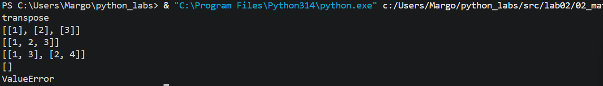

### row_sums
```python
def row_sums(mat: list[list[float | int]]) -> list[float]:
    if any(len(mat[i])!=len(mat[i+1]) for i in range(len(mat)-1)):
            raise ValueError
    return [sum(i) for i in mat]
```
1. **Валидация прямоугольности:** С помощью выражения внутри `any()` проверяется равенство длин всех соседних строк матрицы. Если найдено несоответствие, генерируется ошибка `raise ValueError`.
2. С помощью `[sum(i) for i in mat]` программа последовательно берет каждую подстроку `i` из матрицы `mat`, передает её во встроенную функцию `sum()` и формирует итоговый одномерный список сумм.

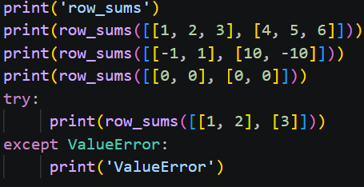
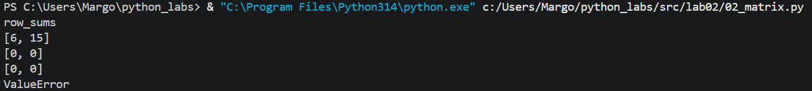

### col_sums
```python
def col_sums(mat: list[list[float | int]]) -> list[float]:
    if any(len(mat[i])!=len(mat[i+1]) for i in range(len(mat)-1)):
                raise ValueError
    return [sum([mat[j][i] for j in range(len(mat))]) for i in range(len(mat[0]))]
```
1. **Валидация прямоугольности:** С помощью выражения внутри `any()` проверяется равенство длин всех соседних строк матрицы. Если найдено несоответствие, генерируется ошибка `raise ValueError`.
2. **Вертикальное суммирование:** Через вложенное списковое включение внешний цикл `for i` задает индекс текущего столбца.
3. **Расчет значений:** Внутренний цикл `for j` извлекает элементы из каждой строки `j` для выбранного столбца `i`, формируя временный список, который сразу передается в функцию `sum()` для подсчета итогового значения столбца.

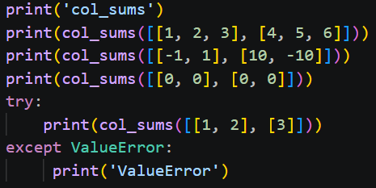
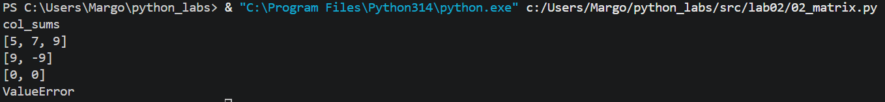

---

### Задание 3 (tuples.py)
```python
def format_record(rec: tuple[str, str, float]) -> str:
    """
    Форматирует кортеж с данными студента в строку.
    
    :rec: Кортеж вида (fio, group, gpa)
    :raise TypeError: Если типы элементов кортежа не соответствуют (str, str, float/int).
    :raise ValueError: Если ФИО или группа пустые после очистки, или GPA вне диапазона [0.0, 5.0].
    :return: Сформированная строка по шаблону.
    """
    if not isinstance(rec, tuple) or len(rec) != 3:
        raise TypeError("Запись должна быть кортежем из 3 элементов")
    fio, group, gpa = rec
    if not isinstance(fio, str) or not isinstance(group, str):
        raise TypeError('ФИО и группа должны быть строками')
    if not isinstance(gpa, (int, float)):
        raise TypeError("GPA должен быть числом")

    fio = fio.split() 
    fio_clean = " ".join(fio)
    if fio_clean == "":
        raise ValueError("ФИО не может быть пустой строкой")
    if group == "":
        raise ValueError("Группа не может быть пустой строкой")
    if not (0.0 <= gpa <= 5.0):
        raise ValueError("GPA должен быть в диапазоне от 0.0 до 5.0")
    
    fio1 = fio[0][0].upper() + fio[0][1:] + " "
    for i in range(len(fio)):
        if i!=0:
            fio1 += fio[i][0].upper() + '.'
    return f"{fio1}, гр. {group.strip()}, GPA {gpa:.2f}"
```
1. **Строгая валидация типов:** Функция проверяет структуру кортежа на длину и типы данных всех трех полей (`str`, `str`, `int/float`). При несоответствии выбрасывается исключение `TypeError`.
2. **Очистка данных:** С помощью `.split()` строка ФИО разбивается по пробелам, что эффективно убирает любые лишние и внутренние дублирующиеся пробельные символы. Пустые значения полей и выход `gpa` за границы `[0.0; 5.0]` вызывают исключение `ValueError`.
3. **Генерация инициалов:** Из полученного списка слов формируется новая строка: первая буква фамилии приводится к верхнему регистру (`.upper()`), а последующие элементы (имя и отчество при наличии) итерируются в цикле, преобразуясь в заглавные буквы с точками.
4. **Вывод результата:** Итоговая строка собирается через f-строку, где пробелы в названии группы зачищаются методом `.strip()`, а оценка округляется ровно до двух знаков после запятой при помощи спецификатора `:.2f`.

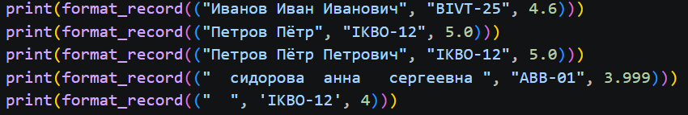
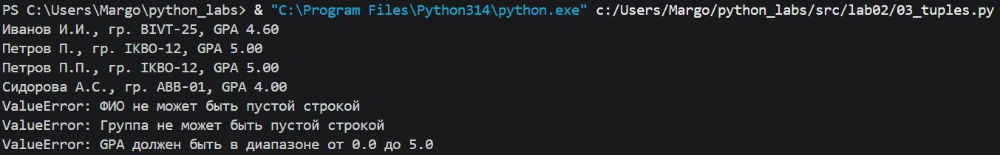

---

# ЛР1 — Ввод/вывод и форматирование
### Задание 1
Прием  данных и вывод приветствия с расчетом возраста через год

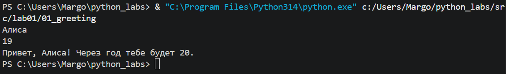

### Задание 2
Расчет суммы и среднего значения вещественных чисел с округлением до двух знаков с помощью f-строк

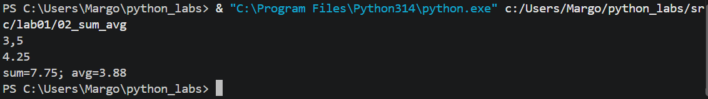

### Задание 3
По формулам последовательно вычисляются базовая стоимость со скидкой, сумма НДС и итоговая сумма к оплате. Результаты выводятся построчно с округлением до двух знаков после запятой

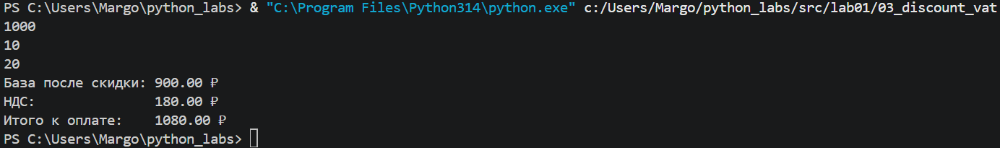

### Задание 4
Программа переводит общее количество минут в часы (через целочисленное деление на 60) и остаток минут (через остаток от деления на 60)

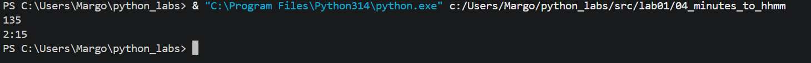

### Задание 5
1. **Очистка и разбиение строки:** split() разбивает введенную строку ФИО по пробелам, автоматически удаляя любые лишние пробелы
2. **Формирование инициалов:** Берутся первые буквы каждого слова (`w[0]`) и склеиваются в одну строку
3. **Расчет длины:** Исходная строка пересобирается через `' '.join(words)` с одиночными пробелами, после чего вычисляется ее корректная длина с помощью функции `len()`

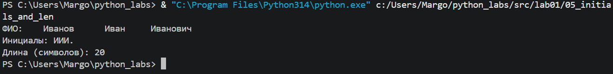

### Задание 6
1. Считывается число строк `N`, а также создаются счетчики для очной (`offline`) и заочной (`online`) форм обучения
2. В цикле `for` каждая строка разбивается на элементы. Последний элемент (`line[-1]`), отвечающий за формат участия, проверяется на равенство строке `True`
3. При совпадении с `True` увеличивается счетчик очников, в противном случае — заочников

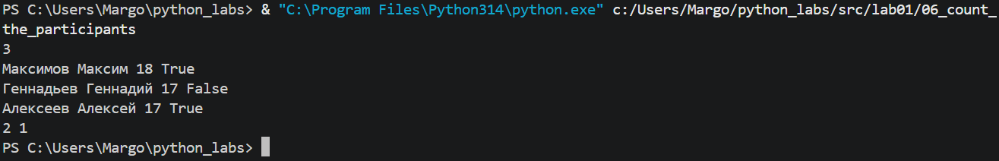

### Задание 7: Декодирование строки
1. **Поиск начала данных:** Программа считывает закодированную строку и находит индекс первой заглавной буквы
2. **Определение шага:** Находится индекс первой цифры, следующей за этой буквой, а затем и индекс второй буквы закдированной строки, на основе чего вычисляется межсимвольный интервал
3. **Декодирование:** Начиная с первой найденной буквы, программа извлекает символы с шагом интервала и собирает их в исходную строку до тех пор, пока не встретит точку

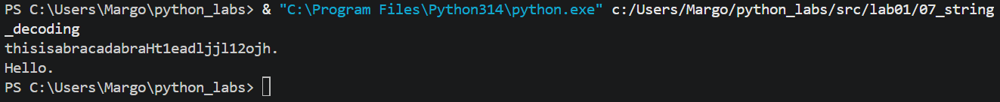